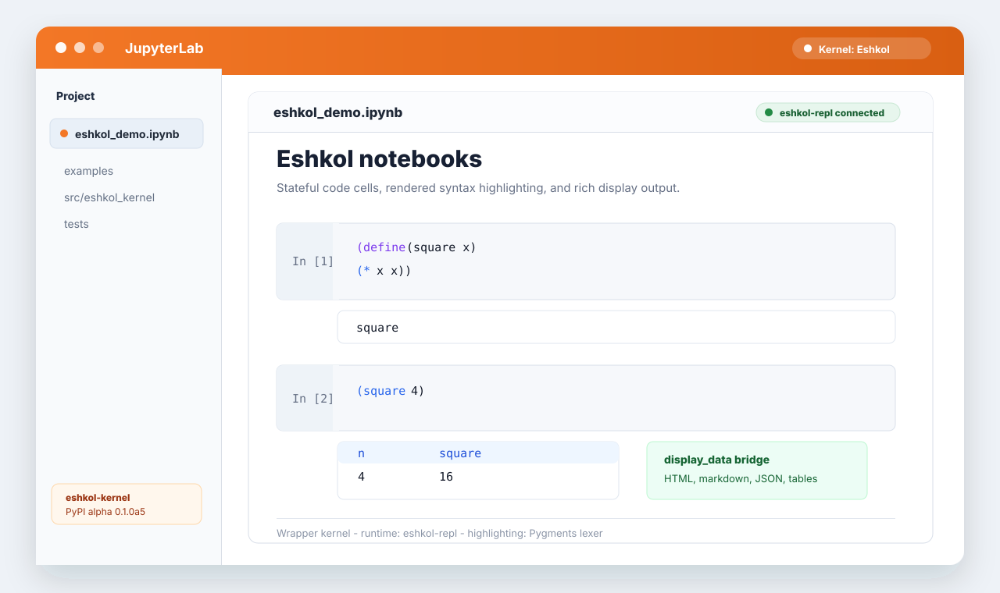

# Eshkol Jupyter Kernel

Run Eshkol in Jupyter notebooks.

`eshkol-kernel` connects JupyterLab, classic Notebook, VS Code notebooks, and
other Jupyter clients to a long-lived `eshkol-repl` process. The result is a
stateful notebook workflow for Eshkol code, examples, experiments, and published
computational notes.



## What You Get

- Stateful Eshkol execution through `eshkol-repl`
- Multiline cells and multiple top-level forms per cell
- Separate text output and return values, structured errors, and ordered rich display output
- Runtime completion for builtins and session-defined symbols
- Eshkol Pygments lexer for rendered notebooks, `.esk` files, and static exports
- Rich display protocol for markdown, HTML, SVG, JSON, LaTeX, PNG, tables, and trees
- One-command setup that can find or download an Eshkol runtime
- Local diagnostics for runtime, kernelspec, shared libraries, and smoke execution

The package is currently alpha. Version `0.1.0a5` is published on
[PyPI](https://pypi.org/project/eshkol-kernel/) and uses the original PTY bridge.
The development checkout described here defaults to the EREPL v1 machine
protocol; it requires a runtime that announces protocol version 1. See
[the protocol policy](docs/MACHINE_PROTOCOL.md) for compatibility and limits.

## Install

For the published PTY-based `0.1.0a5` release, create a Python environment,
install the package with JupyterLab, run setup, and start Jupyter:

```bash
python3 -m venv .venv
. .venv/bin/activate
python -m pip install --upgrade pip
python -m pip install eshkol-kernel==0.1.0a5 jupyterlab
eshkol-kernel-setup --user
python -m jupyter lab
```

Create or open a notebook, select the `Eshkol` kernel, and try:

```scheme
(+ 1 2 3)
```

`eshkol-kernel-setup` uses an existing `eshkol-repl` on `PATH` when available.
If it cannot find one, it downloads the latest compatible Eshkol release into a
user cache directory, installs the Jupyter kernelspec, runs diagnostics, and
prints the next command to launch Jupyter.

To force a specific runtime:

```bash
eshkol-kernel-setup --user --eshkol-repl /absolute/path/to/eshkol-repl
```

For the development machine-mode bridge, install this checkout using the
[development instructions](#development), then select an EREPL v1 runtime:

```bash
eshkol-kernel-setup --user --eshkol-repl /absolute/path/to/erepl-v1/eshkol-repl
python -m jupyter lab
```

An older runtime requires explicit legacy mode in the environment that starts
Jupyter (`ESHKOL_KERNEL_PROTOCOL=legacy python -m jupyter lab`). There is no
automatic protocol downgrade.

## Runtime Model

This package does not vendor Eshkol itself. It is a Jupyter wrapper around an
Eshkol runtime.

Most users should let `eshkol-kernel-setup` configure the runtime and kernelspec:

```bash
eshkol-kernel-setup --user
eshkol-kernel-setup --user --eshkol-repl /absolute/path/to/eshkol-repl
eshkol-kernel-setup --user --runtime-dir ~/.cache/eshkol-kernel/eshkol
eshkol-kernel-setup --user --tag latest --flavor lite
eshkol-kernel-setup --sys-prefix
eshkol-kernel-setup --no-download
```

The kernel reads these environment variables when Jupyter starts it:

- `ESHKOL_REPL`: path to `eshkol-repl` (default: `eshkol-repl`)
- `ESHKOL_KERNEL_PROTOCOL`: `machine` (default, EREPL v1) or explicit `legacy` (PTY)
- `ESHKOL_KERNEL_LOAD_STDLIB`: legacy-mode stdlib loading (`1` by default); machine mode always loads stdlib
- `ESHKOL_KERNEL_REPL_ARGS`: extra arguments passed to `eshkol-repl`
- `ESHKOL_KERNEL_TIMEOUT`: execution timeout per top-level form in seconds (default: `30`)
- `ESHKOL_KERNEL_START_TIMEOUT`: REPL startup/handshake timeout in seconds (default: `120`)

If Jupyter launches from an environment that does not inherit your shell
variables, bake the runtime path into the kernelspec:

```bash
eshkol-kernel-install --user --eshkol-repl /absolute/path/to/eshkol-repl
```

The fetch helper supports release tags and runtime flavors:

```bash
eshkol-kernel-fetch-runtime --tag latest --flavor lite --output .external/eshkol
```

Use `.external/` for local development setup only. The setup command downloads
into a user cache by default; production and packaged setups can point the
kernelspec at any Eshkol installation.

Linux release binaries may require system BLAS/LAPACK and LLVM runtime
libraries. The CI workflow documents the Ubuntu packages currently needed for
the downloaded Eshkol release.

## Diagnostics

`eshkol-kernel-setup` runs diagnostics automatically. Run the doctor command
directly when Jupyter cannot start the kernel or cells fail before evaluating
code:

```bash
eshkol-kernel-doctor
```

It checks the package import, platform support, `eshkol-repl` resolution, shared
library dependencies, the `Eshkol` kernelspec, and a real `(+ 1 2 3)` execution
through the configured protocol (EREPL v1 by default). An installed runtime
that lacks the machine handshake fails that check; the doctor does not silently
select legacy mode.
Point it at a specific runtime when needed:

```bash
eshkol-kernel-doctor --eshkol-repl /absolute/path/to/eshkol-repl
```

Missing kernelspecs are warnings by default so contributors can diagnose the
runtime before installing Jupyter metadata. Use `--require-kernelspec` when
validating a fully installed setup.

## Kernelspec Management

List installed kernels:

```bash
jupyter kernelspec list
```

Update or reinstall the default `Eshkol` kernelspec:

```bash
eshkol-kernel-setup --user --eshkol-repl /absolute/path/to/eshkol-repl
```

Install just the kernelspec without fetching or running diagnostics:

```bash
eshkol-kernel-install --user --eshkol-repl /absolute/path/to/eshkol-repl
```

Install a second kernelspec name for another runtime:

```bash
eshkol-kernel-install --user \
  --name eshkol-dev \
  --display-name "Eshkol Dev" \
  --eshkol-repl /absolute/path/to/dev/eshkol-repl
```

Uninstall the default kernelspec:

```bash
jupyter kernelspec uninstall eshkol
```

## Syntax Highlighting

The package registers an `eshkol` Pygments lexer for `.esk` files and rendered
notebooks. This improves exported notebooks, Sphinx/MkDocs pages, and other
Pygments-based renderers.

Live notebook editors still use Scheme-like CodeMirror behavior until a
dedicated browser-side Eshkol mode exists.

## Rich Display Output

Explicit Eshkol output goes to stdout; machine-mode return values are separate
Jupyter `execute_result` messages, one for each top-level form whose value is not
unspecified. A single stdout line matching this JSON
shape is published as a Jupyter `display_data` MIME bundle instead:

```json
{
  "type": "display_data",
  "data": {
    "text/plain": "hello",
    "text/html": "<strong>hello</strong>"
  },
  "metadata": {}
}
```

The kernel also understands compact helper payloads that Eshkol-side libraries
or user code can emit:

```json
{"type":"eshkol_display","format":"markdown","value":"**hello**"}
{"type":"eshkol_display","format":"html","value":"<strong>hello</strong>"}
{"type":"eshkol_display","format":"svg","value":"<svg>...</svg>"}
{"type":"eshkol_display","format":"json","value":{"answer":42}}
{"type":"eshkol_pretty","value":["define",["square","x"],["*","x","x"]]}
{"type":"eshkol_table","columns":["n","square"],"rows":[[1,1],[2,4]]}
{"type":"eshkol_tree","value":["root",["left"],["right"]]}
```

Supported `eshkol_display` formats are `text`, `html`, `markdown`, `latex`,
`svg`, `json`, `png`, and `png-base64`. The display bridge includes a
`text/plain` fallback when it creates the MIME bundle. Invalid helper payloads
remain plain stdout.

## How It Works

The kernel subclasses `ipykernel.kernelbase.Kernel` and keeps one
`eshkol-repl --machine` subprocess alive across cells. It negotiates EREPL v1,
splits cells into top-level forms, and sends one JSON eval request at a time.
Matching response frames separate explicit stdout, typed return values, and
structured errors. The bridge drains both pipes continuously and uses the
response's captured stdout to avoid racing or duplicating raw pipe output.

Runtime requests also provide completion and completeness; token positions,
indentation suggestions, and documentation lookup remain local. A full reset
restarts the process because protocol `reset` cannot unload JIT definitions.
See [MACHINE_PROTOCOL.md](docs/MACHINE_PROTOCOL.md) for the contract and scope.

## Development

```bash
git clone https://github.com/Gabriel-Kahen/eshkol-jupyter-kernel.git
cd eshkol-jupyter-kernel
python3 -m venv .venv
. .venv/bin/activate
python -m pip install --upgrade pip
python -m pip install -e '.[test,dev]'
ruff check .
python -m build
pytest
```

The default tests use fake runtimes so they can run without Eshkol installed.
They check the client and Jupyter bridge, not native JIT or signal behavior.
Broader real-runtime validation is a separate test effort. To run the existing
real-runtime smoke tests locally, use a runtime that passes the EREPL v1
handshake:

```bash
eshkol-kernel-fetch-runtime --output .external/eshkol
ESHKOL_REAL_REPL="$PWD/.external/eshkol/bin/eshkol-repl" pytest tests/test_real_eshkol.py
eshkol-kernel-doctor --eshkol-repl "$PWD/.external/eshkol/bin/eshkol-repl" --skip-kernelspec
```

The CI workflow includes linting, package builds, fake-runtime tests, notebook
execution tests, and a separate real Eshkol smoke job. A configured/downloaded
release must satisfy the selected protocol; a version label alone is not a
substitute for the handshake.

## Release

Release publishing uses PyPI Trusted Publishing through GitHub Actions. See
[docs/RELEASING.md](docs/RELEASING.md) for the checklist.

## Known Limits

- Machine transport uses subprocess pipes. Windows native runtime and interrupt
  behavior are not verified by this migration. Legacy mode requires a Unix PTY.
- Rich display currently depends on the JSON line convention above.
- Live editor highlighting still uses Scheme-like CodeMirror behavior.
- Machine output arrives after each form finishes because the runtime captures
  stdout. Cross-stream stdout/stderr ordering is not guaranteed.
- Runtime completeness is a delimiter scan, not a full syntax check.
- Interrupt behavior depends on the native runtime and frontend. Restarting the
  kernel clears definitions; protocol `reset` alone does not.
